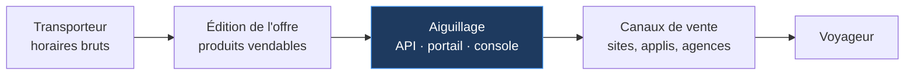

<div align="center">

# Aiguillage

**Une API de distribution ferroviaire traitée comme un produit.**

Le contrat OpenAPI écrit *avant* le code · un portail de documentation généré depuis ce contrat ·
une console d'administration pour piloter les accès.

[](https://aiguillage-delta.vercel.app)
[](#tests)
[](spec/openapi.yaml)
[](https://nextjs.org)
[](tsconfig.json)
[](LICENSE)

[**Voir la démo**](https://aiguillage-delta.vercel.app) ·
[**Le portail de doc**](https://aiguillage-delta.vercel.app/docs) ·
[**Le guide technique**](https://aiguillage-delta.vercel.app/guide) ·
[**Comprendre le projet de zéro**](docs/comprendre-aiguillage.md)

</div>

> Démonstration technique. Transporteurs, lignes et tarifs sont fictifs.

---

## Le problème

Entre les données brutes d'un transporteur et le voyageur qui achète son billet, il y a une chaîne
d'acteurs qui ne se connaissent pas. Aiguillage occupe **le maillon du milieu** : transformer une
offre en produit consommable par des canaux de vente tiers — sites, applications, agences,
revendeurs.



Une API livrée seule est inutilisable. Il en faut trois choses — comme dans une vraie équipe
« API-as-a-Product » :

| Livrable | Où | Ce que c'est |
|---|---|---|
| **L'API v1** | [`/api/v1`](https://aiguillage-delta.vercel.app/api/openapi) | 4 opérations REST, auth par clé, quotas, erreurs RFC 9457 |
| **Le portail de doc** | [`/docs`](https://aiguillage-delta.vercel.app/docs) | Généré depuis `spec/openapi.yaml`, exemples exécutables en direct |
| **La console d'admin** | [`/admin`](https://aiguillage-delta.vercel.app/admin) | Émission/révocation des clés, suivi des quotas, journal d'appels |

## Essayer en trente secondes

Sans rien installer, avec la clé du bac à sable public :

```bash
curl "https://aiguillage-delta.vercel.app/api/v1/stations?q=paris" \
  -H "X-API-Key: agl_live_demo00000000000000000000000000"
```

Puis provoquer une erreur, pour voir ce qu'un intégrateur reçoit quand il se trompe :

```bash
curl "https://aiguillage-delta.vercel.app/api/v1/offers?origin=FRPAR&destination=FRNTE&date=04-08-2026" \
  -H "X-API-Key: agl_live_demo00000000000000000000000000"
```

```json
{
  "type": "https://aiguillage.dev/problems/invalid-request",
  "title": "Requête invalide",
  "status": 400,
  "detail": "Un ou plusieurs paramètres sont invalides.",
  "errors": [{ "field": "date", "message": "Format attendu AAAA-MM-JJ." }]
}
```

Le champ fautif est **nommé**. C'est la différence entre un intégrateur qui corrige son appel en dix
secondes et un intégrateur qui ouvre un ticket.

## Ce que ce projet démontre

### Le contrat a été écrit avant le code

`spec/openapi.yaml` est commité **avant** le premier handler — et `git log` le prouve :

```
ff123b0  docs(spec): contrat OpenAPI v1 ecrit avant toute ligne de code
e8af463  feat(catalogue): horaire roulant genere et verifie contre la spec (GREEN)
```

Tout le monde dit travailler « spec first ». L'ordre des commits, lui, ne se raconte pas.

### La documentation ne *peut pas* mentir

Les tests d'API ne valident pas les réponses contre les attentes du développeur, mais contre **les
schémas publiés dans la spec** (via Ajv) :

```ts
expect(validateResponse("/offers", "get", 200, body).errors).toEqual([]);
```

Servir un champ non documenté, ou en retirer un, fait tomber la suite — `additionalProperties: false`
transforme la spec d'un document *descriptif* en document *prescriptif*. Le portail, lui, ne contient
aucun texte écrit à la main : il lit le même fichier.

C'est la boucle complète du **Spec Driven Development** : une seule source de vérité, vérifiée
mécaniquement des deux côtés.

### Les garanties sont écrites une fois

Authentification, décompte de quota, en-têtes `RateLimit-*` et journal d'usage vivent dans une
enveloppe unique ([`src/lib/handler.ts`](src/lib/handler.ts)). Aucune route ne les réimplémente —
donc aucune route ne peut les oublier.

### Le domaine ne connaît ni HTTP ni base de données

[`src/domain/`](src/domain/) se teste sans serveur et sans stockage. D'où une suite complète qui
tourne **en moins d'une seconde**, et un changement de persistance qui ne touche aucune règle métier.

## Lancer le projet

```bash
git clone https://github.com/RaoulBonsso/aiguillage.git
cd aiguillage
npm install
npm run dev          # http://localhost:3000
```

Aucune variable d'environnement n'est requise : sans configuration, l'application démarre en mode
démonstration avec une clé de bac à sable et un mot de passe d'administration affiché à l'écran.

```bash
curl "http://localhost:3000/api/v1/offers?origin=FRPAR&destination=FRNTE&date=$(date -d '+3 days' +%F)" \
  -H "X-API-Key: agl_live_demo00000000000000000000000000"
```

## Tests

```bash
npm test             # 54 tests, moins d'une seconde
```

| Fichier | Tests | Ce qu'il garantit |
|---|---|---|
| `src/app/api/v1/routes.test.ts` | 18 | **Contrat** : chaque réponse validée contre la spec |
| `src/domain/search.test.ts` | 12 | Filtres, disponibilité selon le groupe, pagination |
| `src/domain/apikeys.test.ts` | 11 | Émission, révocation, quota mensuel, journal |
| `src/data/catalog.test.ts` | 8 | Le catalogue satisfait les schémas publiés |
| `src/lib/session.test.ts` | 5 | Jeton d'admin : valide, altéré, bricolé, périmé, malformé |

## Documentation

Tout est dans [`docs/`](docs/), diagrammes Mermaid compris.

| Document | Contenu |
|---|---|
| [**Comprendre Aiguillage, de zéro**](docs/comprendre-aiguillage.md) | Le projet sans aucun prérequis : métier, vocabulaire expliqué terme par terme, bout en bout, limites |
| [Vue d'ensemble](docs/architecture/01-vue-ensemble.md) | Le métier, les trois couches, ce que le découpage interdit |
| [Le trajet d'une requête](docs/architecture/02-requete-authentifiee.md) | Diagramme de séquence et décisions visibles dessus |
| [Décisions d'architecture](docs/architecture/03-decisions.md) | Six ADR, chacune avec son coût |
| [Le cycle de vie d'une clé](docs/architecture/04-cycle-de-vie-cle.md) | États, transitions, gestion du secret, temps constant |
| [Le contrat d'abord](docs/architecture/05-le-contrat-d-abord.md) | La méthode, et ce qui casse quand on triche |

## Limites assumées

Savoir dire ce qui n'est pas fait vaut mieux que le laisser découvrir.

- **Pas de base de données.** Le stockage des clés est en mémoire : une clé émise depuis la console
  ne survit pas au redémarrage. Choix explicite ([ADR-3](docs/architecture/03-decisions.md)) —
  l'objet du projet est la chaîne API + portail + console. L'interface `KeyStore` est dessinée pour
  recevoir un adaptateur durable : sept méthodes, aucune logique métier.
- **API en lecture seule.** Pas de réservation ni de paiement — ce qui évite au passage les vraies
  questions difficiles (idempotence, transactions distribuées, inventaire).
- **Données fictives**, générées de façon déterministe sur 21 jours glissants.
- **Console d'admin volontairement simple** : un mot de passe, un jeton de session signé. Ni OAuth,
  ni comptes multiples, ni rôles.

## Pile technique

Next.js 16 (App Router) · TypeScript · Zod (validation d'entrée) · Ajv (validation de contrat) ·
Vitest · Tailwind CSS v4 · déployé sur Vercel

## Variables d'environnement

Toutes optionnelles — sans elles, l'application tourne en mode démonstration.

| Variable | Rôle |
|---|---|
| `AIGUILLAGE_ADMIN_PASSWORD` | Mot de passe de la console. Absent = mode démo, mot de passe affiché à l'écran. |
| `AIGUILLAGE_SESSION_SECRET` | Secret de signature des sessions d'administration. |
| `AIGUILLAGE_DEMO_KEY` | Clé du bac à sable public utilisée par le portail. |
| `AIGUILLAGE_DEMO_QUOTA` | Quota mensuel de cette clé (défaut : 500). |

## Licence

[MIT](LICENSE)
