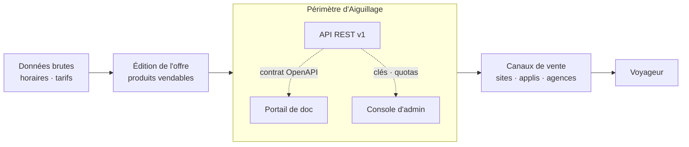
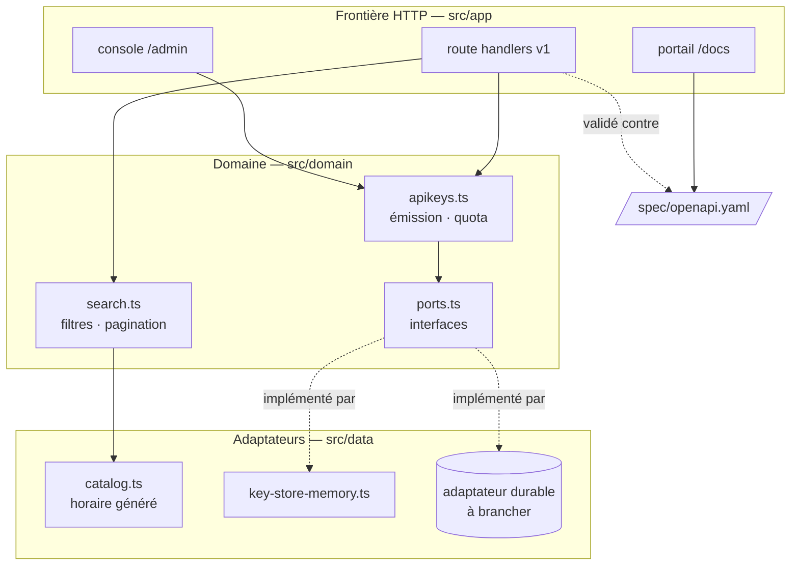

# Vue d'ensemble

## Le problème métier

Dans la distribution ferroviaire, l'information commerciale — horaires, tarifs, disponibilités,
conditions d'échange — doit voyager du transporteur jusqu'aux canaux qui vendent réellement les
billets : sites grand public, applications, agences de voyage, revendeurs tiers.

Aiguillage occupe le maillon du milieu : transformer une offre en **produit consommable par des
tiers**. Ce n'est pas qu'une API — c'est une API *plus* les deux outils sans lesquels personne ne
peut s'en servir : un portail de documentation et une console d'administration.

## Les trois couches du code

La règle est simple : **le métier ne connaît pas HTTP, et HTTP ne connaît pas le stockage.**

Conséquences concrètes :

- `search.ts` et `apikeys.ts` se testent **sans serveur, sans base, en millisecondes**. C'est ce qui
  permet d'avoir une suite complète qui tourne en moins d'une seconde.
- Changer de stockage revient à écrire une classe qui satisfait `KeyStore`. Aucune règle métier
  n'est touchée.
- Le contrat OpenAPI est lu à deux endroits : par le portail (pour l'afficher) et par les tests
  (pour valider les réponses). Il n'est jamais recopié.

## Ce que le découpage interdit

| Tentation | Ce qui l'empêche |
|---|---|
| Documenter un champ qu'on ne sert pas | Les tests de contrat valident chaque réponse contre le schéma publié |
| Servir un champ non documenté | `additionalProperties: false` sur les schémas de la spec |
| Oublier les en-têtes de quota sur une route | L'enveloppe `withApiKey` les pose, aucune route ne les écrit |
| Contourner la garde de session en appelant l'action directement | Chaque action serveur revérifie la session |
