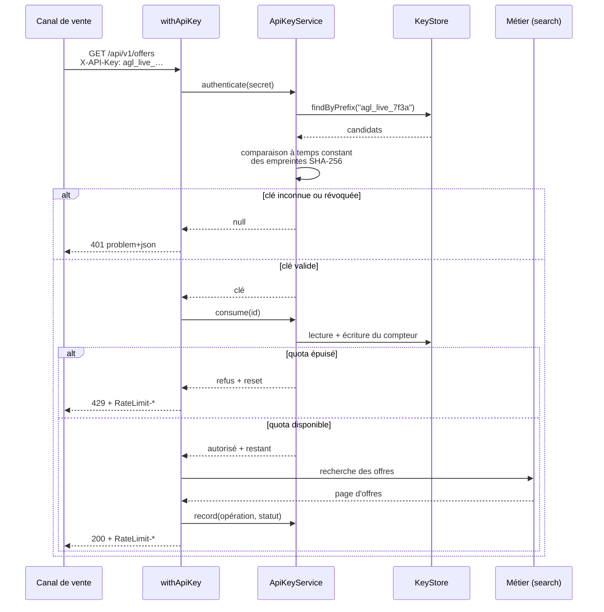

# Le trajet d'une requête authentifiée

Tout appel à l'API v1 traverse la même enveloppe (`src/lib/handler.ts`). Elle est écrite **une
seule fois** : une garantie qu'on réimplémente à chaque route est une garantie qu'on finit par
oublier sur l'une d'elles.

## Les décisions visibles sur ce schéma

**Recherche par préfixe, puis comparaison à temps constant.** On pourrait chercher directement par
empreinte : ce serait plus court, mais la comparaison partirait alors dans le moteur de stockage,
hors de notre contrôle. Ici la vérification du secret est explicite et se fait en temps constant —
comparer avec `===` laisserait fuir, par le temps de réponse, le nombre de caractères devinés.

**Le quota est décompté avant le métier, pas après.** Une requête refusée ne doit rien coûter en
calcul. C'est aussi ce qui permet de renvoyer un `429` sans avoir touché au catalogue.

**Les en-têtes `RateLimit-*` sont posés sur toutes les réponses**, pas seulement sur les refus. Un
intégrateur doit pouvoir ralentir *avant* de se faire refuser, pas après.

**`/me` ne consomme pas de quota.** Demander « combien me reste-t-il ? » ne doit pas en retirer un.
C'est le genre de détail qui ne se voit qu'à l'usage — et qui distingue une API pensée pour ses
consommateurs d'une API pensée pour son auteur.

**Le journal est écrit après la réponse**, avec le statut réel. Il enregistre donc aussi les `404`
et les `429`, qui sont précisément ce qu'un administrateur veut voir quand un canal se plaint.
