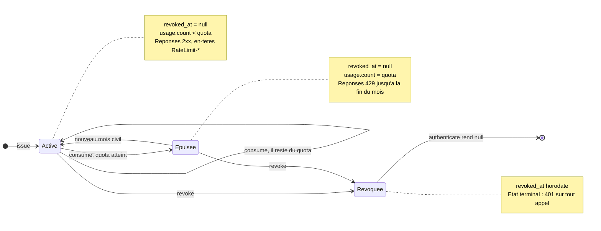
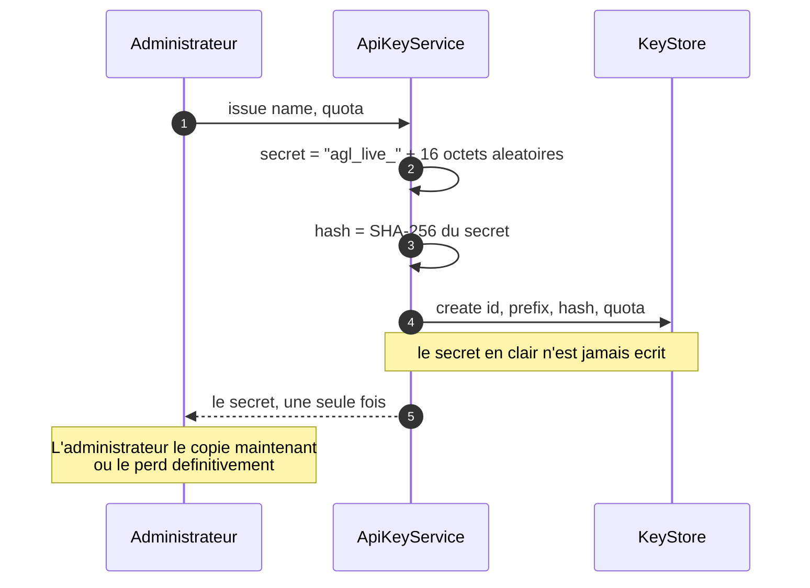

# Le cycle de vie d'une clé d'API

Une clé d'API n'est pas une ligne dans une table : c'est un objet qui **change d'état dans le
temps**, et dont chaque transition a une conséquence visible pour le canal de vente qui l'utilise.
Ce document décrit ces états, qui les déclenche, et ce que le client reçoit dans chaque cas.

Le code correspondant tient dans un seul fichier : [`src/domain/apikeys.ts`](../../src/domain/apikeys.ts).

## Les états



### Ce que chaque transition veut dire

| Transition | Déclencheur | Ce que voit le canal de vente |
|---|---|---|
| `[*] → Active` | Un administrateur émet la clé depuis `/admin` | Le secret s'affiche **une seule fois**, jamais relisible ensuite |
| `Active → Active` | Un appel consomme une unité de quota | `200` et `RateLimit-Remaining` décrémenté |
| `Active → Épuisée` | L'appel qui atteint le quota | `429` et `RateLimit-Reset` en secondes |
| `Épuisée → Active` | Changement de mois civil, sans intervention | Les appels repassent en `200` |
| `→ Révoquée` | Un administrateur révoque la clé | `401` immédiat, sur tous les appels |

## Trois choses que ce schéma rend visibles

**« Épuisée » n'est pas un état stocké.** Il n'existe aucun champ `status` dans `ApiKeyRecord`. L'état
se **déduit** à la lecture, en comparant `usage.count` à `quota` pour la période courante. C'est ce qui
rend la transition `Épuisée → Active` gratuite : personne n'a besoin de passer à minuit le 1er du mois
pour réarmer les compteurs. Un enregistrement dont la période est révolue compte pour zéro, c'est tout.

```ts
// src/domain/apikeys.ts
function fenetreCourante(record: ApiKeyRecord, instant: Date): number {
  return record.usage.period === periode(instant) ? record.usage.count : 0;
}
```

Retenir la règle générale : **un état qui se calcule ne se stocke pas.** Le stocker, c'est créer une
seconde source de vérité qu'il faudra maintenir synchronisée — et une tâche planifiée qui, un jour,
ne tournera pas.

**La révocation est un horodatage, pas une suppression.** `revoke` pose `revoked_at` et ne supprime
rien. On garde donc l'historique : quelle clé existait, qui s'en servait, quand elle a été coupée. Une
clé supprimée efface aussi la trace de ses appels, ce qui est exactement ce qu'on ne veut pas le jour
d'un incident.

**Le quota est décompté avant l'exécution du métier.** Une requête refusée ne doit rien coûter en
calcul — c'est ce qui permet de répondre `429` sans avoir touché au catalogue. La contrepartie assumée :
une requête qui échoue *après* le décompte (une `404`, par exemple) a quand même consommé son unité.
C'est le choix standard des API commerciales — on facture l'appel, pas le succès.

## Le secret, lui, ne vit qu'un instant



Ce qui est stocké : l'identifiant, le nom, le **préfixe** — les 13 premiers caractères, non secrets,
qui servent à reconnaître la clé dans la console — l'empreinte SHA-256, le quota et les compteurs.
Jamais le secret.

Conséquence pratique : personne, pas même l'administrateur, ne peut retrouver une clé perdue. La seule
réponse possible est d'en émettre une nouvelle et de révoquer l'ancienne. C'est le comportement de
Stripe, de GitHub et de toutes les API sérieuses — et c'est une contrainte qu'il faut annoncer dans
l'interface, ce que fait la console.

## Pourquoi chercher par préfixe et non par empreinte

La vérification d'un secret pourrait tenir en une ligne : chercher directement l'enregistrement dont
l'empreinte vaut `SHA-256(secret)`. Ce n'est **pas** ce que fait le code.

```ts
const candidats = await this.store.findByPrefix(secret.slice(0, PREFIXE.length + 4));
const trouvee = candidats.find((candidat) => memeEmpreinte(candidat.hash, empreinte));
```

La raison est que la comparaison finale doit se faire **à temps constant**, sous notre contrôle.
Chercher par empreinte déléguerait cette comparaison au moteur de stockage — un index de base de
données, dont le temps de réponse dépend des données. Comparer avec `===` ou laisser un index le faire
laisse fuir, par la durée de la réponse, le nombre de caractères devinés par un attaquant.

Le préfixe, lui, n'est pas un secret : il est affiché en clair dans la console. Le filtrer d'abord ne
révèle rien et réduit la comparaison à temps constant à une poignée de candidats.

C'est une décision qui coûte une méthode de plus dans l'interface `KeyStore` (`findByPrefix`), et qui
se paierait sur un volume très élevé de clés partageant un préfixe. À l'échelle d'une plateforme de
distribution — des centaines de canaux, pas des millions — le compromis est évidemment bon.
