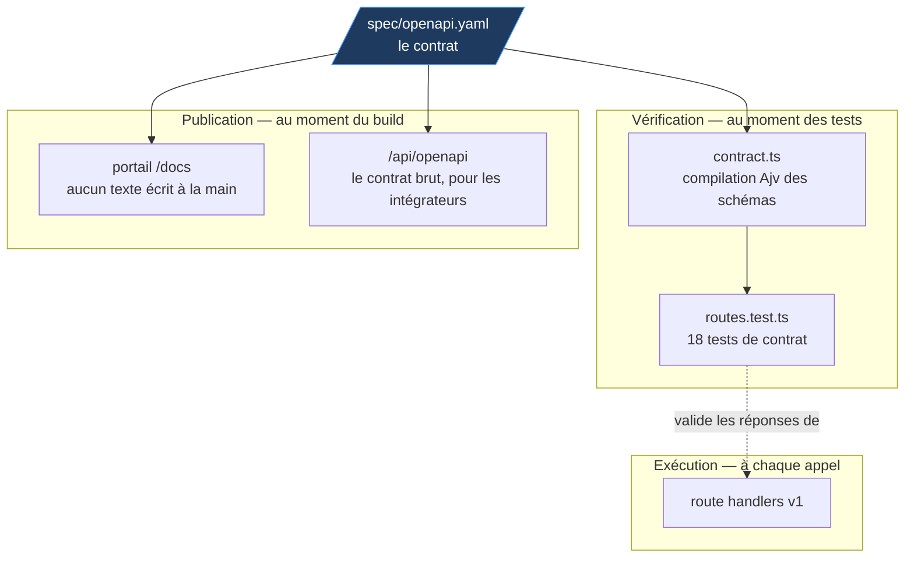
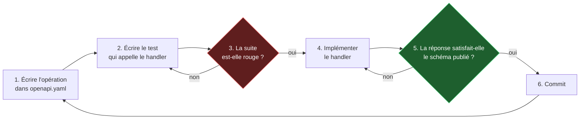
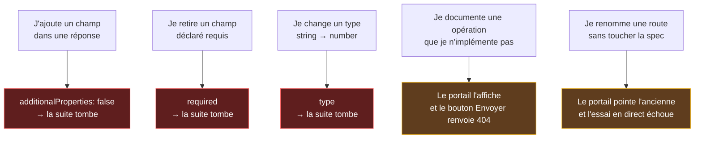

# Le contrat d'abord : comment la doc devient impossible à désynchroniser

Tout le monde dit travailler « spec first ». Ce document montre ce que ça change **mécaniquement**,
c'est-à-dire ce qui casse quand on triche.

## Le fichier dont tout dépend

`spec/openapi.yaml` n'est pas une documentation produite après coup. C'est le seul endroit où les
quatre opérations, leurs paramètres, leurs réponses et leurs erreurs sont décrits. Trois
consommateurs le lisent, et aucun n'en garde de copie.



| Consommateur | Quand il lit la spec | Le type de dérive qu'il rend impossible |
|---|---|---|
| **Les tests de contrat** | À chaque `npm test` | Servir un champ non documenté, ou en retirer un documenté |
| **Le portail `/docs`** | Au build | Une page de doc qui décrit une version antérieure de l'API |
| **`/api/openapi`** | À chaque requête | Un intégrateur qui génère son client depuis un contrat périmé |

La propriété qui compte est celle-ci : **il n'existe aucun chemin par lequel une information de la
spec est recopiée à la main.** Une documentation qui duplique son sujet finit toujours par le
contredire.

## La boucle de travail

C'est un cycle TDD, mais dont l'étape rouge est produite par le contrat plutôt que par une attente
écrite à la main.



L'étape 5 est celle qui fait tout le travail. Le test ne compare pas la réponse à un objet attendu
écrit par le développeur — il la valide contre **le schéma publié dans la spec**, pour ce couple
(chemin, méthode, statut) :

```ts
// src/app/api/v1/routes.test.ts
expect(validateResponse("/offers", "get", 200, body).errors).toEqual([]);
```

On compare la liste d'erreurs à `[]` plutôt que de tester un booléen : quand la validation échoue,
le message dit *quel champ* et *pourquoi*, au lieu de `expected false to be true`. Un test qui
échoue doit se diagnostiquer sans ouvrir le débogueur.

Écrire soi-même l'objet attendu ne prouve que la cohérence du développeur avec lui-même. Valider
contre la spec prouve la cohérence du code avec **ce qui est promis aux intégrateurs**. Ce n'est pas
le même test, et ce n'est pas la même garantie.

## Ce qui casse quand on triche

C'est le meilleur test d'une méthode : que se passe-t-il si on essaie de la contourner ?



Les trois premiers cas sont attrapés **avant le commit**, par la suite de tests. Les deux derniers
sont attrapés à l'usage, sur le portail — moins bien, mais visibles immédiatement par quiconque
ouvre la page.

Le point important à savoir défendre : `additionalProperties: false` n'est pas un détail de
configuration, c'est ce qui transforme la spec d'un document *descriptif* en document *prescriptif*.
Sans lui, la spec dit « la réponse contient au moins ces champs » et n'interdit rien. Avec lui, elle
dit « la réponse contient exactement ces champs », et toute dérive devient une suite rouge.

## Le coût, honnêtement

Cette méthode n'est pas gratuite.

**Modifier une réponse demande de toucher deux fichiers, dans l'ordre.** La spec, puis
l'implémentation. C'est volontairement contraignant : c'est là toute l'idée. Sur un prototype jetable,
cette contrainte est du pur ralentissement et il ne faut pas la payer.

**Les schémas doivent rester au bon niveau de précision.** Trop lâches, ils ne garantissent rien ;
trop rigides, la moindre évolution casse trente tests et l'équipe finit par les désactiver — ce qui
est pire que ne pas en avoir. Le curseur retenu ici : contraindre **les champs et leurs types**, pas
leurs valeurs. Un test qui vérifie qu'un prix vaut exactement 4900 centimes teste le jeu de données,
pas le contrat.

**La spec devient un fichier critique.** Une erreur dedans se propage aux tests *et* au portail. En
contrepartie, elle est relue avec l'attention qu'on accorde au code — ce qui est exactement le
statut qu'on veut lui donner.

## La preuve, pas l'affirmation

L'ordre des commits ne se raconte pas :

```
ff123b0  docs(spec): contrat OpenAPI v1 ecrit avant toute ligne de code
e8af463  feat(catalogue): horaire roulant genere et verifie contre la spec (GREEN)
b09dc6b  feat(recherche): filtres, disponibilite adaptee au groupe et pagination (GREEN)
b28f5fb  feat(cles): emission, revocation, quota mensuel et journal d'usage (GREEN)
12172ef  feat(api): quatre operations v1 servies et validees contre la spec (GREEN)
```

Le contrat est commité avant le premier handler. C'est vérifiable en une commande — `git log --oneline`
— et c'est la seule forme de preuve qui vaille quelque chose en entretien.
