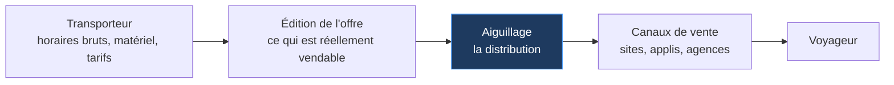
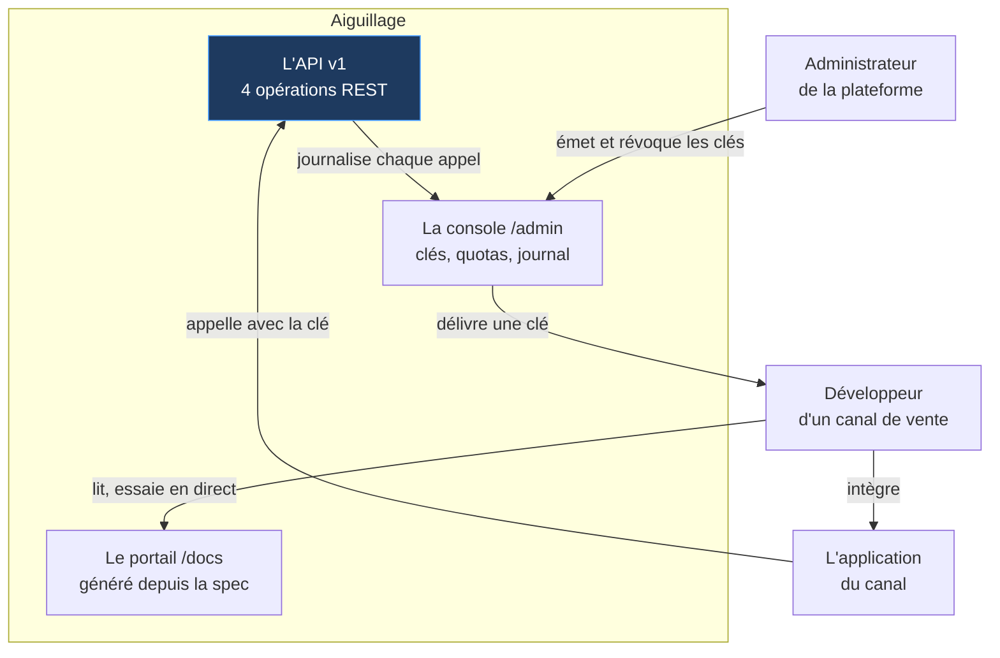
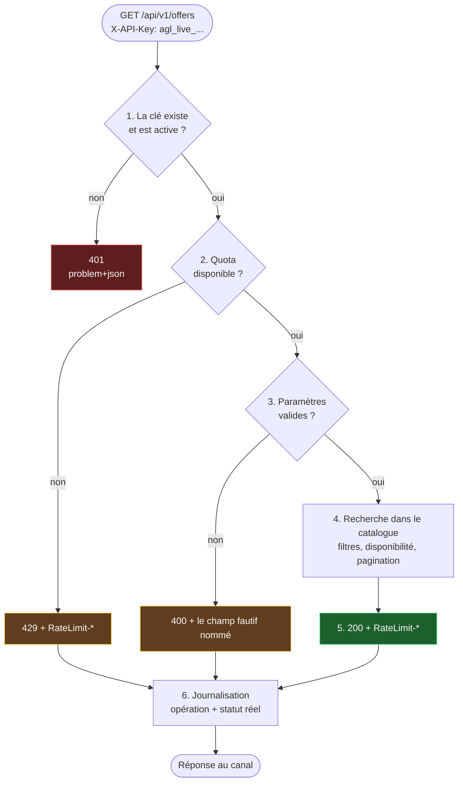

# Comprendre Aiguillage, de zéro

Ce document part du principe que tu ne connais rien au projet, ni au vocabulaire des API. Il
explique **ce qu'on a construit, pourquoi, et ce que chaque mot veut dire** — dans l'ordre où les
questions se posent naturellement.

Les autres documents supposent le vocabulaire acquis. Celui-ci le donne.

**Sommaire**

1. [Le projet en une phrase](#1-le-projet-en-une-phrase)
2. [Le problème métier : pourquoi cette API existe](#2-le-problème-métier--pourquoi-cette-api-existe)
3. [Le vocabulaire, terme par terme](#3-le-vocabulaire-terme-par-terme)
4. [Le tour du propriétaire : les trois livrables](#4-le-tour-du-propriétaire--les-trois-livrables)
5. [De bout en bout : la vie d'un appel](#5-de-bout-en-bout--la-vie-dun-appel)
6. [Les six décisions, en une ligne chacune](#6-les-six-décisions-en-une-ligne-chacune)
7. [Ce que le projet ne fait pas](#7-ce-que-le-projet-ne-fait-pas)

---

## 1. Le projet en une phrase

> Aiguillage est une **API de distribution ferroviaire** — elle expose horaires, tarifs et
> disponibilités à des sites et applications qui vendent des billets — livrée avec les deux outils
> sans lesquels personne ne peut s'en servir : un **portail de documentation** et une **console
> d'administration**.

Le point qui fait la valeur du projet n'est pas l'API elle-même. C'est la **méthode** : le contrat a
été écrit avant le code, et la documentation est générée depuis ce contrat, donc elle ne peut pas
mentir.

---

## 2. Le problème métier : pourquoi cette API existe

Quand tu achètes un billet de train sur un comparateur, ce comparateur n'a pas les données du
transporteur dans sa base. Il les **demande**, en direct, à une API. Entre les données brutes du
transporteur et le voyageur, il y a une chaîne d'acteurs qui ne se connaissent pas.



| Maillon | Sa question | Ce qu'il produit |
|---|---|---|
| **Transporteur** | Quels trains font quoi ? | Des horaires et du matériel roulant |
| **Édition de l'offre** | Qu'est-ce qu'on vend, et à quel prix ? | Des produits vendables |
| **Aiguillage** | Comment un tiers consomme ça, de façon fiable ? | **Une API, sa doc, ses accès** |
| **Canaux de vente** | Comment j'affiche et j'encaisse ? | Une expérience d'achat |

Aiguillage occupe **le maillon du milieu**. Son métier n'est pas de calculer des trains : c'est de
transformer une offre en **produit consommable par des tiers**. Ce qui veut dire, très
concrètement : un contrat stable, une documentation exacte, des accès qu'on peut ouvrir et couper,
et des erreurs qu'un développeur externe comprend sans appeler personne.

C'est exactement le métier d'une équipe « API-as-a-Product ».

---

## 3. Le vocabulaire, terme par terme

Chaque terme est donné avec sa définition, puis avec **ce qu'il faut savoir en dire** — parce que
connaître un mot et savoir l'expliquer sont deux choses différentes.

### API REST

**Définition.** Une API est une porte d'entrée programmatique : un logiciel appelle un autre
logiciel. « REST » est un style d'architecture dans lequel on expose des **ressources** — ici des
gares, des offres — désignées par des URL, manipulées par les verbes HTTP (`GET` pour lire, `POST`
pour créer…).

**Dans le projet.** Quatre opérations, toutes en lecture :

| Opération | URL | Ce qu'elle rend |
|---|---|---|
| `listStations` | `GET /api/v1/stations` | Le référentiel des gares, avec recherche |
| `searchOffers` | `GET /api/v1/offers` | Les offres d'un trajet à une date |
| `getOffer` | `GET /api/v1/offers/{offerId}` | Le détail d'une offre |
| `getCurrentKey` | `GET /api/v1/me` | L'état de sa propre clé et de son quota |

**Ce qu'il faut savoir en dire.** Le `/v1` dans l'URL est un choix : il permet de publier un jour une
`v2` incompatible sans casser les clients existants, qui continuent d'appeler `v1`. Sur une API
consommée par des tiers qu'on ne contrôle pas, on ne peut pas « juste mettre à jour tout le monde ».

### OpenAPI, spec, contrat

Ces trois mots désignent la même chose ici.

**Définition.** **OpenAPI** est un format standard pour décrire une API dans un fichier — les URL,
les paramètres, la forme exacte des réponses, les erreurs possibles. Le fichier s'appelle une
**spec** (spécification). On l'appelle **contrat** quand on veut insister sur le fait qu'il engage :
c'est la promesse faite aux intégrateurs.

**Dans le projet.** [`spec/openapi.yaml`](../spec/openapi.yaml), 432 lignes. Il est servi tel quel sur
[`/api/openapi`](https://aiguillage-delta.vercel.app/api/openapi).

**Ce qu'il faut savoir en dire.** L'intérêt d'un format standard est l'outillage : depuis ce fichier,
un intégrateur **génère automatiquement** son client dans son langage, ses tests, ses jeux d'essai.
Une doc en PDF ou en page Notion ne permet rien de tout ça.

### Spec Driven Development (« le contrat d'abord »)

**Définition.** Écrire le contrat **avant** le code, et s'en servir ensuite comme source unique de
vérité.

**Pourquoi ça change quelque chose.** Écrire la spec d'abord force à répondre tout de suite aux
questions qu'on repousse habituellement jusqu'à ce qu'il soit trop tard :

- Comment on pagine ?
- À quoi ressemble exactement une erreur ?
- Quels champs sont obligatoires ?
- Que se passe-t-il quand le quota est atteint ?

Ces réponses coûtent **une heure avant le code**, et **une migration après** — parce qu'une fois que
des tiers consomment l'API, changer la forme d'une réponse casse leur production.

**Ce qu'il faut savoir en dire.** La preuve n'est pas dans l'affirmation, elle est dans
`git log --oneline` : le commit `ff123b0 docs(spec): contrat OpenAPI v1 écrit avant toute ligne de
code` **précède** le premier handler. Tout le monde dit travailler spec first ; l'ordre des commits,
lui, ne se raconte pas.

### Test de contrat

C'est le concept central du projet. Il mérite qu'on distingue trois choses souvent confondues.

| Type de test | Ce qu'il compare | Ce qu'il prouve |
|---|---|---|
| **Test unitaire** | Une fonction à un résultat attendu | Que la fonction fait ce que le dev a écrit |
| **Test d'intégration** | Plusieurs modules ensemble | Qu'ils s'assemblent |
| **Test de contrat** | Une réponse au **schéma publié** | Que le code respecte **ce qui est promis aux clients** |

**La nuance qui compte.** Un test classique s'écrit ainsi :

```ts
expect(body).toEqual({ code: "FRPAR", name: "Paris Gare de Lyon", /* … */ });
```

Ce test ne prouve que la cohérence du développeur **avec lui-même**. Si le dev s'est trompé dans la
doc, le test passe quand même.

Un test de contrat s'écrit ainsi :

```ts
expect(validateResponse("/offers", "get", 200, body).errors).toEqual([]);
```

Il va chercher, dans `spec/openapi.yaml`, le schéma déclaré pour `GET /offers` en statut `200`, et
vérifie que la réponse le satisfait. Si le code sert un champ non documenté, **la suite tombe**.

**Le mécanisme précis.** Une bibliothèque appelée **Ajv** compile les schémas JSON de la spec en
fonctions de validation. La clé de voûte est l'option `additionalProperties: false` dans les
schémas : sans elle, la spec dit « la réponse contient *au moins* ces champs » et n'interdit rien ;
avec elle, elle dit « la réponse contient *exactement* ces champs ». C'est ce qui transforme la spec
d'un document **descriptif** en document **prescriptif**.

**Ce qu'il faut savoir en dire.** 18 des 54 tests du projet sont des tests de contrat. Ils rendent la
dérive de la documentation *impossible à commiter*, au lieu de compter sur la discipline de
quelqu'un.

### Quota et rate limiting

**Deux notions qu'on confond, et qui répondent à des besoins opposés.**

| | Quota | Rate limiting |
|---|---|---|
| **La question** | Combien d'appels ce client a-t-il payés ? | L'infrastructure tient-elle le choc ? |
| **L'échelle** | Le mois | La seconde |
| **La nature** | Commerciale | Technique |
| **L'algorithme typique** | Compteur par période civile | Token bucket, fenêtre glissante |

**Dans le projet.** C'est un **quota** : chaque clé porte `{ période: "2026-08", compteur: 42 }` et
une limite mensuelle. Le réarmement au 1er du mois n'est pas une tâche planifiée — c'est un simple
changement d'étiquette : un enregistrement dont la période est révolue compte pour zéro.

**Ce qu'il faut savoir en dire.** Le choix est assumé et documenté ([ADR-5](architecture/03-decisions.md)) :
un quota commercial mensuel *est* une notion civile — le client comprend « 10 000 appels par mois »,
pas « 10 000 appels sur toute fenêtre glissante de 30 jours ». Le coût est réel : ce n'est pas un
lissage, un canal peut consommer tout son quota le 1er du mois. Si le besoin était de protéger
l'infrastructure contre les pics, il faudrait un token bucket — **c'est un autre problème**.

Savoir dire cette dernière phrase vaut plus que connaître les deux algorithmes.

### Les en-têtes `RateLimit-*`

**Définition.** Trois en-têtes HTTP posés sur les réponses : `RateLimit-Limit` (la limite),
`RateLimit-Remaining` (ce qui reste), `RateLimit-Reset` (secondes avant réarmement).

**Ce qu'il faut savoir en dire.** Ils sont posés sur **toutes** les réponses des opérations qui
décomptent, pas seulement sur les refus. La raison est du point de vue du client : un intégrateur
doit pouvoir ralentir **avant** de se faire refuser, pas après. Une API qui ne prévient qu'au moment
du `429` oblige chaque client à découvrir sa limite en la heurtant.

Vérifiable en une commande :

```bash
curl -sD- -o/dev/null "https://aiguillage-delta.vercel.app/api/v1/stations?q=paris" \
  -H "X-API-Key: agl_live_demo00000000000000000000000000" | grep -i ratelimit
```

### RFC 9457 — `application/problem+json`

**Définition.** Un format standard de message d'erreur HTTP. Au lieu d'inventer
`{ "error": "date invalide" }`, on renvoie un objet normalisé :

```json
{
  "type": "https://aiguillage.dev/problems/invalid-request",
  "title": "Requête invalide",
  "status": 400,
  "detail": "Un ou plusieurs paramètres sont invalides.",
  "errors": [{ "field": "date", "message": "Format attendu AAAA-MM-JJ." }]
}
```

**Ce qu'il faut savoir en dire.** Le champ décisif est `type` : c'est un identifiant **stable et
documenté**, et c'est dessus que le client branche sa logique (`if (probleme.type.endsWith("/quota-exceeded"))`).
Les textes `title` et `detail` restent librement modifiables — on peut les reformuler ou les traduire
sans casser personne. Un format maison force au contraire chaque intégrateur à **parser du texte
d'erreur**, ce qui se casse à la première correction de faute de frappe.

Le tableau `errors`, champ par champ, fait la différence entre un intégrateur qui corrige son appel
en dix secondes et un intégrateur qui ouvre un ticket.

### Idempotence

**Définition.** Une opération est idempotente si l'appeler dix fois produit le même effet que
l'appeler une fois.

**Dans le projet.** Les quatre opérations sont des `GET` : elles ne modifient rien, donc elles sont
idempotentes **par construction**. La question ne se pose pas vraiment ici.

**Ce qu'il faut savoir en dire** — et c'est là que la réponse devient intéressante. La question
deviendrait sérieuse en ajoutant la **réservation** (`POST /bookings`) : si le réseau coupe après
l'envoi mais avant la réponse, le client ne sait pas si la réservation a été prise, et rejouer son
appel risque de réserver deux fois. La solution standard est la **clé d'idempotence** : le client
génère un identifiant unique, l'envoie dans un en-tête `Idempotency-Key`, et le serveur qui revoit
cette clé renvoie la réponse d'origine au lieu de refaire l'opération.

Répondre « mes opérations sont toutes des `GET`, donc la question se poserait à la réservation, et
voilà comment je la traiterais » vaut beaucoup mieux que réciter une définition.

### Port et adaptateur (architecture hexagonale)

**Définition.** Un **port** est une interface qui dit *de quoi le métier a besoin*, sans dire qui le
fournit. Un **adaptateur** est une implémentation concrète de ce port.

**Dans le projet.** Le port est l'interface `KeyStore` ([`src/domain/ports.ts`](../src/domain/ports.ts)) :
sept méthodes, aucune logique métier — `create`, `findById`, `findByPrefix`, `update`, `all`,
`appendUsage`, `recentUsage`. L'adaptateur livré est `InMemoryKeyStore`
([`src/data/key-store-memory.ts`](../src/data/key-store-memory.ts)).

**Ce qu'il faut savoir en dire.** L'intérêt n'est pas théorique, il est mesurable : le domaine ne
connaît ni HTTP ni base de données, donc il se teste **sans serveur et sans stockage**. C'est ce qui
donne une suite complète en moins d'une seconde. Et brancher Firestore ou Postgres devient une classe
d'une centaine de lignes, sans toucher **une seule ligne** de règle métier.

Piège classique en entretien : si tu dis « architecture hexagonale », on te demandera de définir un
port et un adaptateur. Réponds par les noms réels du projet, pas par la théorie.

### Empreinte, SHA-256, comparaison à temps constant

**Définition.** Une **empreinte** (ou *hash*) est le résultat d'une fonction à sens unique : depuis
le secret on calcule l'empreinte, mais depuis l'empreinte on ne peut pas remonter au secret.

**Dans le projet.** Le secret d'une clé n'existe en clair **qu'une seule fois** : à l'émission, dans
la réponse à l'administrateur. Ce qui est stocké, c'est l'empreinte SHA-256 plus un **préfixe** non
secret (13 caractères) qui sert à reconnaître la clé dans la console.

**La comparaison à temps constant.** Vérifier une empreinte avec `===` semble anodin. Mais `===`
s'arrête au premier caractère différent : comparer deux chaînes identiques prend plus longtemps que
comparer deux chaînes qui diffèrent d'entrée. En mesurant les temps de réponse, un attaquant peut
donc deviner le secret caractère par caractère. On utilise `timingSafeEqual`, qui compare toujours
tous les octets.

**Ce qu'il faut savoir en dire.** « Le coût est nul, l'omission serait une faute. » C'est le genre de
détail qui distingue quelqu'un qui a lu la doc de sécurité de quelqu'un qui a copié un tutoriel.

### ISR (Incremental Static Regeneration)

**Définition.** Une stratégie de rendu de Next.js : la page est générée d'avance (rapide, comme du
statique) mais **régénérée automatiquement** après un délai donné.

**Dans le projet.** Les pages du portail qui affichent des exemples sont régénérées toutes les
heures. La raison est concrète : le catalogue roule sur 21 jours glissants, donc une date d'exemple
figée au build finirait par pointer un jour où plus aucun train ne circule — et le bouton
« Envoyer » du portail renverrait une liste vide en pleine démonstration.

---

## 4. Le tour du propriétaire : les trois livrables

Une API livrée seule est inutilisable. Il en faut trois.



| Livrable | Pour qui | Sans lui |
|---|---|---|
| **L'API** `/api/v1` | Les applications | Rien à vendre |
| **Le portail** `/docs` | Les développeurs intégrateurs | Chaque intégration devient un échange de mails |
| **La console** `/admin` | L'exploitant de la plateforme | Impossible d'ouvrir un accès, de le couper, ou de savoir qui appelle |

Ce triptyque est le vrai sujet du projet. Une API sans portail ni console n'est pas un produit, c'est
un serveur.

---

## 5. De bout en bout : la vie d'un appel

Voici ce qui se passe entre le moment où un canal de vente lance sa requête et celui où il reçoit sa
réponse. Toutes les garanties sont posées par une **enveloppe unique**,
[`src/lib/handler.ts`](../src/lib/handler.ts) — écrite une seule fois, jamais recopiée.



**L'ordre des étapes n'est pas arbitraire.** Chacune est placée là pour une raison qu'il faut savoir
défendre :

| Étape | Pourquoi ici et pas ailleurs |
|---|---|
| **1. Authentification en premier** | Inutile de valider les paramètres d'un appelant qu'on va refuser |
| **2. Quota avant le métier** | Une requête refusée ne doit **rien coûter en calcul** — d'où un `429` sans toucher au catalogue |
| **3. Validation avant le métier** | Le métier ne reçoit que des données déjà saines : il n'a pas à se défendre |
| **6. Journal après la réponse** | Il enregistre le **statut réel**, donc aussi les `404` et `429` — précisément ce qu'un admin veut voir quand un canal se plaint |

**Une exception à connaître.** `/me` ne consomme **pas** de quota : demander « combien me
reste-t-il ? » ne doit pas en retirer un. C'est un détail qui ne se voit qu'à l'usage, et qui
distingue une API pensée pour ses consommateurs d'une API pensée pour son auteur.

Pour le détail des échanges internes, voir
[Le trajet d'une requête authentifiée](architecture/02-requete-authentifiee.md).

---

## 6. Les six décisions, en une ligne chacune

Le détail, avec le **coût** de chaque décision, est dans
[`architecture/03-decisions.md`](architecture/03-decisions.md). Une décision sans inconvénient est une
décision qu'on n'a pas vraiment prise.

| | Décision | Le coût assumé |
|---|---|---|
| **ADR-1** | Écrire le contrat OpenAPI avant le code | Modifier une réponse = toucher deux fichiers, dans l'ordre |
| **ADR-2** | Valider les réponses contre la spec dans les tests | Trouver le bon niveau de précision des schémas |
| **ADR-3** | Le stockage des clés derrière un port, en mémoire | **Les clés ne survivent pas au redémarrage** |
| **ADR-4** | Erreurs au format RFC 9457 | Un format de plus à respecter partout |
| **ADR-5** | Quota par période civile, pas fenêtre glissante | Pas de lissage : tout le quota peut partir le 1er |
| **ADR-6** | Un catalogue généré plutôt qu'un jeu figé | Les pages d'exemples doivent être régénérées (ISR) |

---

## 7. Ce que le projet ne fait pas

Savoir énoncer les limites **avant** qu'on te les demande est un signe de maturité technique. Les
voici, sans enrobage.

**Il n'y a pas de base de données.** Les clés vivent en mémoire. Une clé émise depuis la console ne
survit pas au redémarrage de l'instance. C'est un choix explicite ([ADR-3](architecture/03-decisions.md)),
pas un oubli : l'objet du projet est la chaîne API + portail + console. L'interface `KeyStore` a été
dessinée pour recevoir un adaptateur durable.

**Les données sont fictives.** Transporteurs, lignes et tarifs sont inventés. Le catalogue est
**généré** de façon déterministe à partir d'un graphe de lignes, sur 21 jours glissants.

**L'API est en lecture seule.** Pas de réservation, pas de paiement, pas d'annulation. Ajouter la
réservation ouvrirait les vraies questions difficiles : idempotence, transactions distribuées,
gestion de l'inventaire, compensation en cas d'échec de paiement.

**Il n'y a qu'une version.** `v1` seulement. La stratégie de versionnage est prévue dans les URL mais
n'a jamais été éprouvée par un changement cassant réel.

**L'authentification de la console est simple** : un mot de passe et un jeton de session signé. Pas
d'OAuth, pas de comptes multiples, pas de rôles. Suffisant pour une démonstration, insuffisant pour
une plateforme réelle.

---

## Pour aller plus loin

| Document | Ce qu'il contient |
|---|---|
| [Vue d'ensemble](architecture/01-vue-ensemble.md) | Le métier, les trois couches, ce que le découpage interdit |
| [Le trajet d'une requête](architecture/02-requete-authentifiee.md) | Diagramme de séquence détaillé |
| [Les décisions](architecture/03-decisions.md) | Six ADR, chacune avec son coût |
| [Le cycle de vie d'une clé](architecture/04-cycle-de-vie-cle.md) | États, transitions, gestion du secret |
| [Le contrat d'abord](architecture/05-le-contrat-d-abord.md) | La méthode, et ce qui casse quand on triche |
| [Fiche d'entretien](demo-entretien.md) | Démo minutée, questions pièges, réponses |
